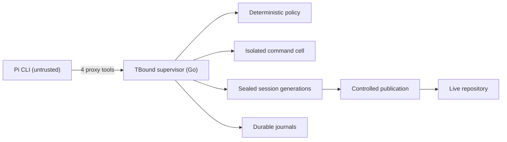

# trust-boundary (tbound)

TBound is a Linux supervisor for the Pi coding agent. Pi proposes four kinds of
tool call: `read`, `write`, `edit`, and `bash`. TBound checks each call against a
fixed policy, runs `bash` in an isolated container, and publishes changes to your
repository only when the policy allows them. Pi and the model are treated as
untrusted. The Go supervisor owns the decisions, the durable state, and the
evidence.

TBound is also the artifact of a master thesis. Its study records sit beside the
code, and [docs/research](docs/research/README.md) explains which is which.

## How it works

Pi and the model never decide what reaches the repository. Every tool call is
checked, `bash` runs in a fresh rootless Podman cell, and writes reach the live
repository only through publication.

## Which path are you on?

| You want to | Start here |
|---|---|
| Build the code and run its checks | [Quickstart](docs/guides/quickstart.md) (about 30 minutes) |
| Run a task or use the product chat | [Use TBound](USAGE.md) |
| Look up a command or flag | [Command reference](docs/cli.md) |
| Understand a term such as PVR, freeze, or cell | [Glossary](docs/glossary.md) |
| Set up a governed Linux host (operators) | [Governed host setup](docs/guides/governed-setup.md), then [reproduction](docs/guides/reproduce.md) |
| Contribute a change | [CONTRIBUTING.md](CONTRIBUTING.md) |
| Read the study records and the thesis | [Research index](docs/research/README.md) |
| Find any other guide | [Documentation index](docs/README.md) |

Supported platforms: Linux amd64 (native or a VM). Windows can build and test
TBound through WSL 2 with Ubuntu, but WSL is not a governed host. Native Windows
and macOS are not supported.

## Current status

[OVERVIEW.md](OVERVIEW.md) is the only current-state file. Tests, fixtures,
probes, and pilot reports are not thesis results, and the main hypothesis has not
been run. The optional [web chat](extensions/webchat/README.md) is frozen and
outside the thesis.

## Status and support

TBound is the artifact of a master's thesis, not a supported product. There is no
support SLA and no security support. Issues and pull requests are welcome, but
responses are not guaranteed.

| Included in this repository | Not included |
|---|---|
| Supervisor, adapter, installer, and packaging | Model provider keys and credentials |
| Guides, command reference, and glossary | The thesis text, in a separate repository |
| Test corpus and study evidence records | The pinned benchmark source clones |
| CI configuration and release tooling | A published npm package, planned after v0.1.0 |

## Product chat

The product service runs governed chat turns on one Linux host, from the terminal
(`tbound chat`). A browser client is the optional, frozen web chat in
`extensions/webchat/`. Reads run through the policy gate. A write waits for
your Publish or Discard. The chat worker is the supervisor's own agent loop, not
Pi, and its output is not thesis evidence.

- [Run a first governed product turn](docs/guides/product-first-turn.md)
- [Enable Bash in the product service](docs/guides/product-bash.md)
- [Try the product demo from Windows](docs/guides/product-demo-windows.md)

## Repository map

- `supervisor/`: Go commands, policy gate, broker, session state, Linux runtime,
  publication, independent effect checks, and evaluation tools.
- `adapter/`: the Pi CLI extension and broker transport.
- `install/`, `scripts/`, `packaging/`: installation, build, and release assets.
- `infra/`: host preparation, guest provisioning, freeze tooling, and the operator dispatcher.
- `docs/`: guides, runtime contracts, decisions, and design notes.
- `corpus/`, `evidence/`, `infra/freeze/`: study inputs and frozen records. See
  [docs/research](docs/research/README.md) before editing them.
- `extensions/webchat/`: the frozen optional web chat extension.
- `assets/`: the banner and logo artwork.
- `thesis/`: a local, gitignored checkout of the thesis repository, if you have one.
